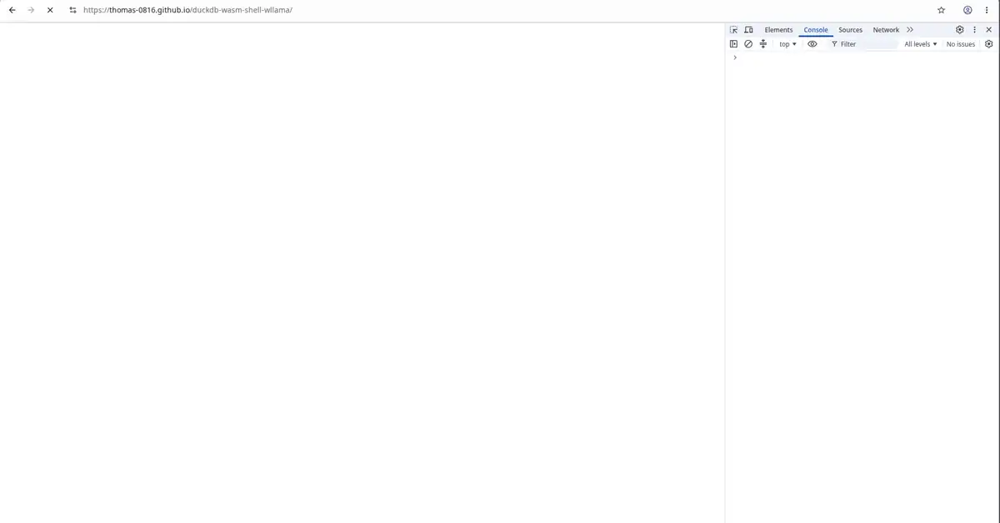

# DuckDB WASM Shell + Chat

A browser-only SQL workbench: the official DuckDB v2 WebAssembly shell on the
left and a small local LLM chat on the right. The chat model runs with
llama.cpp (through wllama) and can inspect the live database, run SQL, and
search the bundled DuckDB manual.

**Live demo: https://thomas-0816.github.io/duckdb-wasm-shell-wllama/**

**Only Chromium-based browsers with WebGPU are supported.** It is tested with
recent Chrome, Chromium, and ungoogled-chromium builds. Firefox and Safari
are not supported. A CPU fallback exists, but it is much slower and is not
the intended mode.

## Demo Video

[](https://thomas-0816.github.io/duckdb-wasm-shell-wllama/demo.mp4)

> **Experimental proof of concept**
>
> This project is a proof of concept, not a production tool. Expect rough
> edges, model mistakes, and browser-specific behavior. APIs, models, and the
> UI may change without notice.

## Requirements

- A recent Chrome, Chromium, or ungoogled-chromium build with WebGPU enabled.
- A GPU supported by the browser (Vulkan on Linux, D3D12 on Windows, Metal on
  macOS).
- Internet access on first load for CDN assets and model downloads.
- Enough free disk space for the model cache (0.5 GB to 2.6 GB per model).
- Enough GPU memory for the selected model. Start with the default 0.8B model.

WebGPU is enabled by default in current Chrome releases on most platforms. The
flags below are still useful for older builds, ungoogled-chromium, and Linux.
If Chrome is already running, close all instances first, or pass a separate
`--user-data-dir`.

### Built with

- DuckDB v2 WebAssembly shell and engine.
- xterm.js for the terminal.
- wllama, a WebAssembly/WebGPU wrapper around llama.cpp, for local GGUF
  inference.
- Hugging Face Hub for model downloads.
- Plain JavaScript, HTML, and CSS. No application build step.

## Launch with WebGPU

| Platform | Flags | WebGPU backend |
| --- | --- | --- |
| Linux | `--enable-unsafe-webgpu --enable-features=Vulkan` | Vulkan |
| Windows | `--enable-unsafe-webgpu` | D3D12 |
| macOS | `--enable-unsafe-webgpu` | Metal |

### Linux

```sh
chrome --enable-unsafe-webgpu --enable-features=Vulkan https://thomas-0816.github.io/duckdb-wasm-shell-wllama/
chromium --enable-unsafe-webgpu --enable-features=Vulkan https://thomas-0816.github.io/duckdb-wasm-shell-wllama/
ungoogled-chromium --enable-unsafe-webgpu --enable-features=Vulkan https://thomas-0816.github.io/duckdb-wasm-shell-wllama/
```

### Windows

Windows uses D3D12 for WebGPU. `--enable-features=Vulkan` is Linux-specific and
is normally not needed here.

```bat
"C:\Program Files\Google\Chrome\Application\chrome.exe" --enable-unsafe-webgpu https://thomas-0816.github.io/duckdb-wasm-shell-wllama/
"C:\Program Files\Chromium\Application\chrome.exe" --enable-unsafe-webgpu https://thomas-0816.github.io/duckdb-wasm-shell-wllama/
```

Adjust the executable path to match your installation.

### macOS

macOS uses Metal for WebGPU. `--enable-features=Vulkan` is Linux-specific and
is normally not needed here.

```sh
"/Applications/Google Chrome.app/Contents/MacOS/Google Chrome" --enable-unsafe-webgpu https://thomas-0816.github.io/duckdb-wasm-shell-wllama/
"/Applications/Chromium.app/Contents/MacOS/Chromium" --enable-unsafe-webgpu https://thomas-0816.github.io/duckdb-wasm-shell-wllama/
"/Applications/ungoogled-chromium.app/Contents/MacOS/ungoogled-chromium" --enable-unsafe-webgpu https://thomas-0816.github.io/duckdb-wasm-shell-wllama/
```

If WebGPU still does not start, open `chrome://gpu` and check the WebGPU status.
On some Linux systems, adding `--ignore-gpu-blocklist` helps. On Windows and
macOS, current stable Chrome normally enables WebGPU without any flags.

## What it does

The page has two resizable panels.

### Left: DuckDB shell

- Runs the official DuckDB v2 web shell frontend and engine in WebAssembly.
- Uses xterm.js for the terminal.
- Supports the normal shell commands, including `.help`, `.mode`, history,
  and SQL execution.
- Has an Import button for CSV, Parquet, JSON, and DuckDB files.
- The database is in-memory, so data is lost when the page is refreshed unless
  you export it.

### Right: local chat

- Runs a small GGUF model locally with wllama, which wraps llama.cpp compiled
  to WebAssembly/WebGPU.
- Model weights are downloaded directly from Hugging Face and cached in the
  browser. No server performs inference.
- The model can call two tools:
  - `query(sql)`: executes one SQL statement in the shell and returns the
    result in the shell's current output mode.
  - `help(keywords)`: searches the bundled DuckDB manual.
- The last 500 lines of shell output are included with each prompt, so you can
  ask follow-up questions about earlier query results.
- A status bar shows model download progress, token throughput, and errors.
- The Cached models dialog shows what is stored in the browser and can clear it.

## How it works

```text
Browser
  Left panel
    xterm.js <-> DuckDB v2 frontend <-> Web Worker <-> duckdb-eh wasm

  Right panel
    chat UI <-> wllama <-> local GGUF model (WebGPU)
                   |
                   +-> query() -> DuckDB shell
                   +-> help()  -> bundled manual index
```

### Shell path

`duckdb-main.js` creates a `DuckShell` from `duckdb-shell.js`.

1. A worker starts early and downloads the DuckDB engine from
   `shell.duckdb.org`.
2. The official DuckDB v2 shell frontend is loaded from the same CDN.
3. The frontend talks to the engine worker over a small binary wire protocol.
4. `DuckShell` syncs `window.termCols` and `window.termRows` with xterm after
   every resize. This keeps the shell's line wrapping and cursor accounting in
   sync with the terminal.

The xterm.js runtime and addon are loaded from jsDelivr. The DuckDB engine and
frontend are loaded from the official DuckDB shell CDN.

### Chat path

`duckdb-chat-app.js` imports `Wllama` from the local `wllama/index.min.js` and
points it at the local `wllama/wllama.wasm`. wllama is the browser wrapper
around llama.cpp: llama.cpp is compiled to WebAssembly, and its WebGPU backend
runs the model on the GPU. Model weights come from Hugging Face at runtime.

When a message is sent:

1. The chat builds a prompt from the system prompt, conversation, and recent
   shell output.
2. The model streams a response.
3. If the model calls `query`, the SQL runs in the shell and the result is
   added to the conversation.
4. If the model calls `help`, the bundled documentation index is searched and
   matching manual sections are added to the conversation.
5. Tool iterations repeat until the model returns a final answer.

Generation runs in a worker. Stopping during normal token generation aborts
the request. Stopping during prompt processing ("Thinking...") cannot interrupt
the worker cleanly, so the worker is terminated and the model is reloaded from
the browser cache.

### Bundled manual

The searchable DuckDB manual is stored in `duckdb-docs.txt`, with its index in
`duckdb-docs-index.json`. The search implementation is described in the next
section.

## How the manual search works

The `help` tool does not send the whole manual to the model. It searches the
manual locally and returns only the top four matching sections. Two files are
used:

- `duckdb-docs.txt`: the full DuckDB manual.
- `duckdb-docs-index.json`: a compact index with section metadata and token
  postings.

### Building the index

`npm run build:docs-index` runs `duckdb-docs-build-index.mjs`. It does this:

1. Splits the manual at Markdown headings (`#` through `######`).
2. Records each section's title, anchor, heading level, start line, line count,
   body length, and whether it has body text.
3. Lowercases every section and extracts tokens with `[a-z0-9_]+`.
4. Expands underscore tokens into every contiguous subform. For example,
   `read_csv_auto` also contributes `read_csv`, `read`, `csv`, `auto`,
   `csv_auto`, and so on. This lets a function-name query find the right pages.
5. Builds an inverted index: term -> section ids.
6. Writes the section table and the sorted term list to
   `duckdb-docs-index.json`.

Section bodies stay in the text file. The index only stores metadata and
postings, so it stays around 2.4 MB and loads quickly.

### Searching at runtime

`searchDuckDBDocs()` in `duckdb-docs.js` does this:

1. **Parse the query.** Split on whitespace, keep quoted text as one phrase,
   lowercase everything, remove duplicates, and use at most eight terms.
2. **Expand terms.** The full term gets weight 1. `read_csv_auto` also searches
   `read_csv` at weight 0.4. Underscore-separated parts of at least three
   characters get weight 0.25.
3. **Find candidate sections.**
   - Short or ambiguous terms scan every section. This keeps substring queries
     working as expected.
   - Longer terms use the postings index and also expand prefixes, so `selec`
     can find `select`. The sorted vocabulary is searched with binary search.
   - Every candidate is verified with `indexOf`, so the postings are only a
     fast filter and cannot produce false matches.
   - Candidate lists are cached per term.
4. **Score the sections.**
   - Rare terms get more weight with inverse document frequency:
     `log((sections + 1) / (frequency + 1)) + 1`.
   - Each occurrence adds `weight * (1 + log(1 + count))`.
   - A term in the title gets a large bonus.
   - Coverage rewards sections that contain every original query term.
   - A length factor favors focused sections over giant API reference pages.
   - An exact phrase in the title, an all-terms title, and higher-level
     headings add more points. Sections without an anchor lose points.
5. **Take the top four sections.**
6. **Build a snippet.** It skips the heading line, finds the line with the most
   term hits, keeps four lines before and twelve lines after, expands the range
   to complete fenced code blocks, caps the result at 1,600 characters, and
   closes any cut-off code fence.
7. **Return Markdown.** Each result is a `### Title {#anchor}` heading followed
   by the snippet. The chat renders it with the Markdown renderer, and DuckDB
   internal anchors are turned into `duckdb.org` documentation links.

The manual and index are fetched once with `cache: force-cache` and preloaded
while the browser is idle. Section bodies and lowercase copies are cached on
first use, so later searches avoid both the network and the full manual scan.

## Models

Models are configured in `duckdb-chat-config.js`. Each model is a GGUF file
executed by llama.cpp. The default is Qwen3.5 0.8B.

| Key | Model | Hugging Face repo | File | Size |
| --- | --- | --- | --- | --- |
| `qwen3.5-0.8b` | Qwen3.5 0.8B | `ggml-org/Qwen3.5-0.8B-GGUF` | `Qwen3.5-0.8B-Q4_0.gguf` | 0.5 GB |
| `qwen3.5-2b` | Qwen3.5 2B | `unsloth/Qwen3.5-2B-GGUF` | `Qwen3.5-2B-UD-Q4_K_XL.gguf` | 1.2 GB |
| `qwen3.5-4b` | Qwen3.5 4B | `unsloth/Qwen3.5-4B-GGUF` | `Qwen3.5-4B-UD-Q4_K_XL.gguf` | 2.6 GB |
| `minicpm5-1b` | MiniCPM5 1B | `openbmb/MiniCPM5-1B-GGUF` | `MiniCPM5-1B-Q4_K_M.gguf` | 0.7 GB |
| `lfm3-1.7b` | LFM3 1.7B | `LiquidAI/LFM3-1.7B-GGUF` | `LFM3-1.7B-QAD-Q4_0.gguf` | 1.0 GB |

All models use a 16,384-token context. The LFM3 entry is present in the config
but disabled in the model selector. Check each model's license before use;
LFM3 has commercial usage restrictions.

The first load downloads the selected model. Later loads reuse the browser
cache. Larger models need more GPU memory and may fail on low-end hardware.

## Run locally

The site is static. Any static file server works.

```sh
cd duckdb-wasm-shell-wllama
python3 -m http.server 8081
```

Then open `http://localhost:8081/`.

There is no build step for the app. The docs index can be rebuilt with Node:

```sh
npm run build:docs-index
```

This script uses only Node built-ins, so `npm install` is not required.

## Project files

| File | Purpose |
| --- | --- |
| `index.html` | Page layout, xterm CDN assets, shell and chat panels |
| `index.css` | Layout, theme, terminal, chat, and responsive styles |
| `duckdb-main.js` | Bootstrap: shell, chat, docs preload, test hooks |
| `duckdb-shell.js` | DuckDB v2 frontend loader, worker transport, terminal integration |
| `duckdb-chat-app.js` | Chat UI, streaming, tool calls, model loading, stop handling |
| `duckdb-chat-config.js` | Model list, system prompt, tool definitions, wllama wasm path |
| `duckdb-docs.js` | Manual and index loader, search and snippet extraction |
| `duckdb-docs.txt` | Bundled DuckDB manual |
| `duckdb-docs-index.json` | Section metadata and token postings |
| `duckdb-docs-build-index.mjs` | Rebuilds the search index |
| `duckdb-markdown.js` | Small safe Markdown renderer for chat output |
| `duckdb-resizer.js` | Draggable shell/chat split with saved width |
| `duckdb-utils.js` | Small DOM, formatting, and escaping helpers |
| `wllama/index.min.js` | Local wllama browser runtime (llama.cpp wrapper) |
| `wllama/wllama.wasm` | Local llama.cpp WebAssembly build used by wllama |
| `demo.mp4` | Demo recording embedded in this README |
| `demo-preview.webp` | Looping animated preview embedded in this README |
| `demo-poster.jpg` | Poster frame for the demo video |
| `.nojekyll` | Tells GitHub Pages to serve files without Jekyll |
| `README.md` | This file |

## Deployment

The demo is deployed with GitHub Pages from the `main` branch, repository root.
`.nojekyll` disables Jekyll so the static files are served as-is. The manual is
stored as `duckdb-docs.txt` because Jekyll tries to process Markdown files and
fails on the manual's Liquid-like link syntax.

## Limitations

- This is an experimental proof of concept.
- WebGPU currently works only in Chrome and other Chromium-based browsers.
  Firefox and Safari are not supported.
- Small models can produce wrong SQL, ignore tools, or hallucinate DuckDB
  behavior. Use the shell and the bundled manual as the source of truth.
- CPU fallback works but is significantly slower.
- Model downloads are large and the browser cache can be cleared at any time.
- Data lives in memory and is lost on refresh.
- WebGPU support and available GPU memory vary by browser and device.
- Do not load sensitive data into a public demo.

## License

MIT. See [LICENSE](LICENSE).
